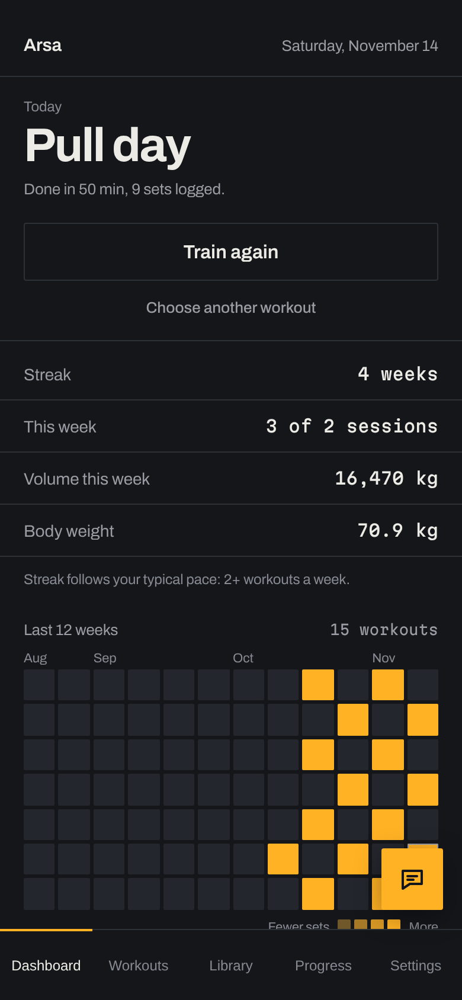
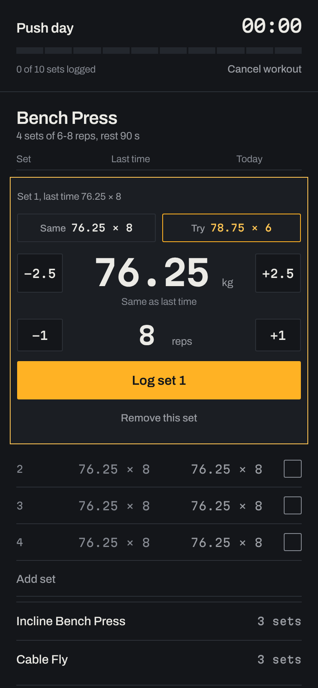
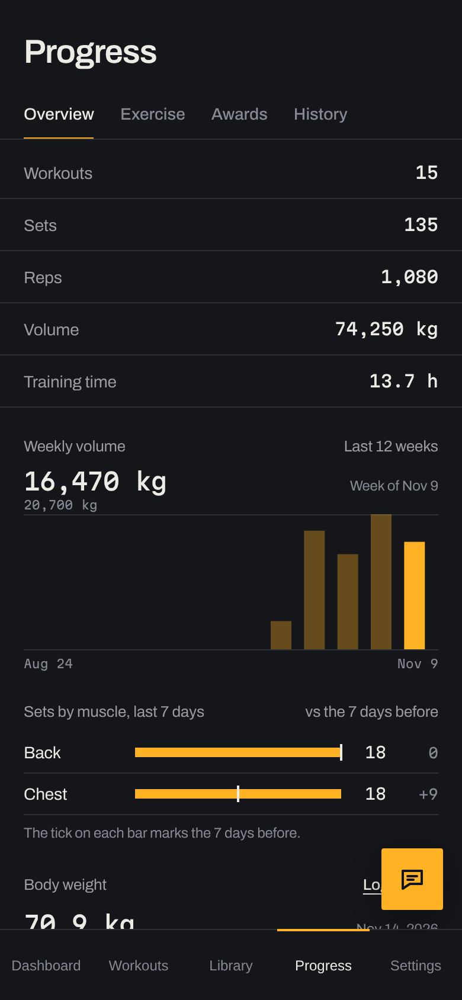
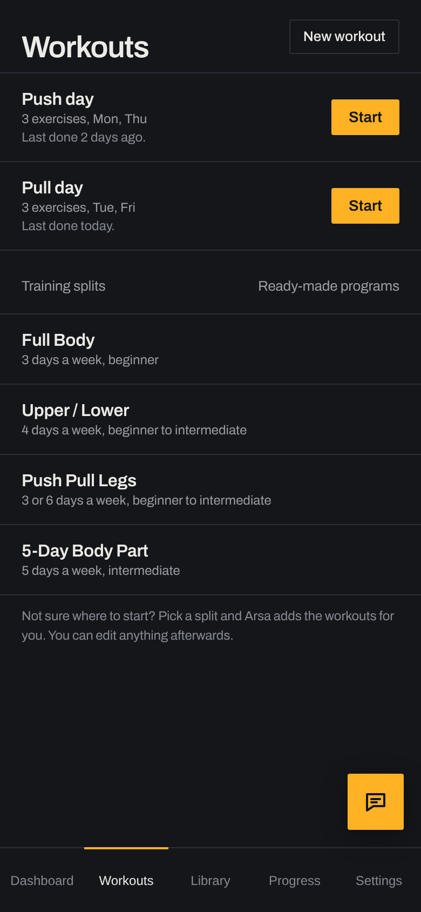
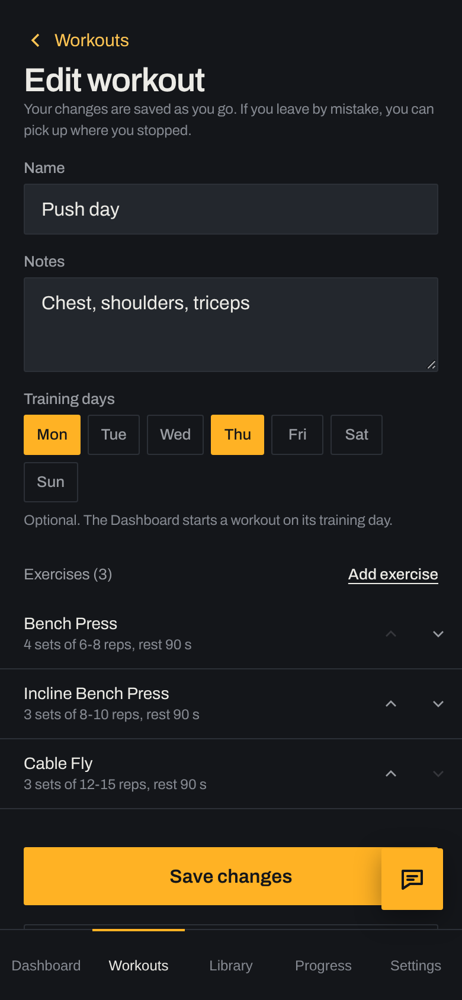
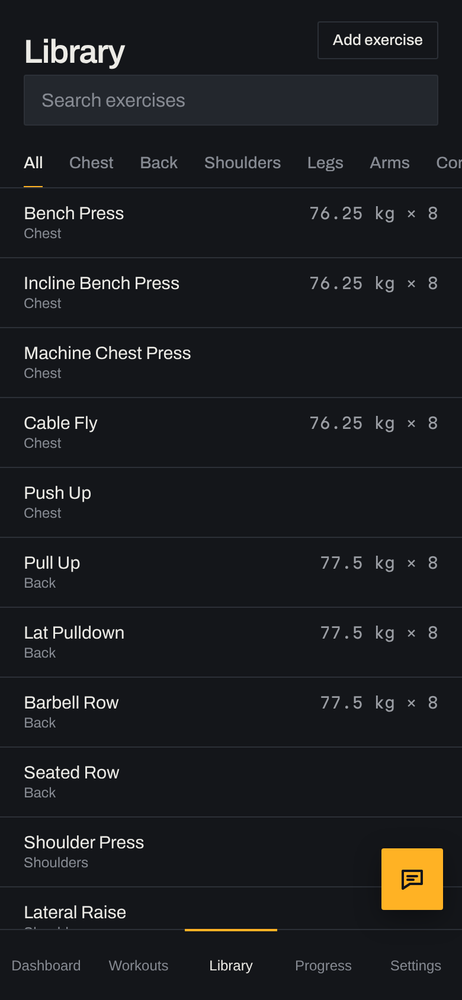
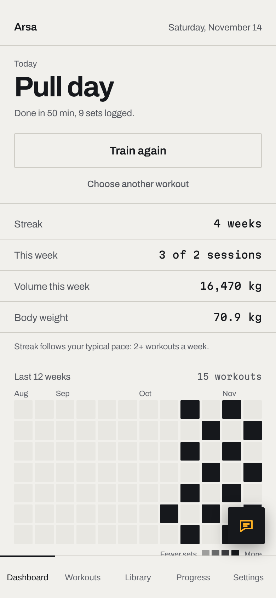
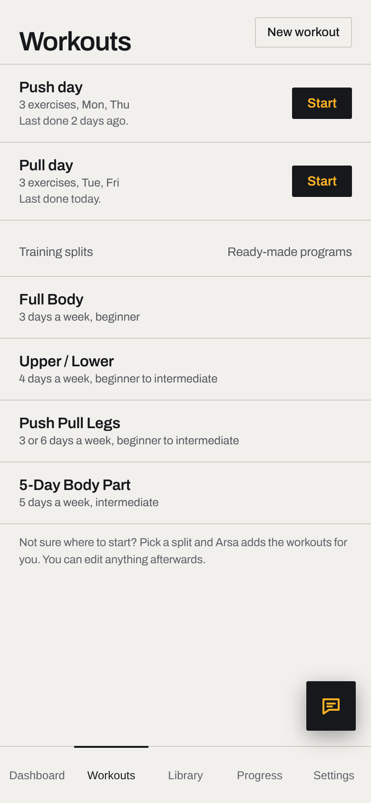
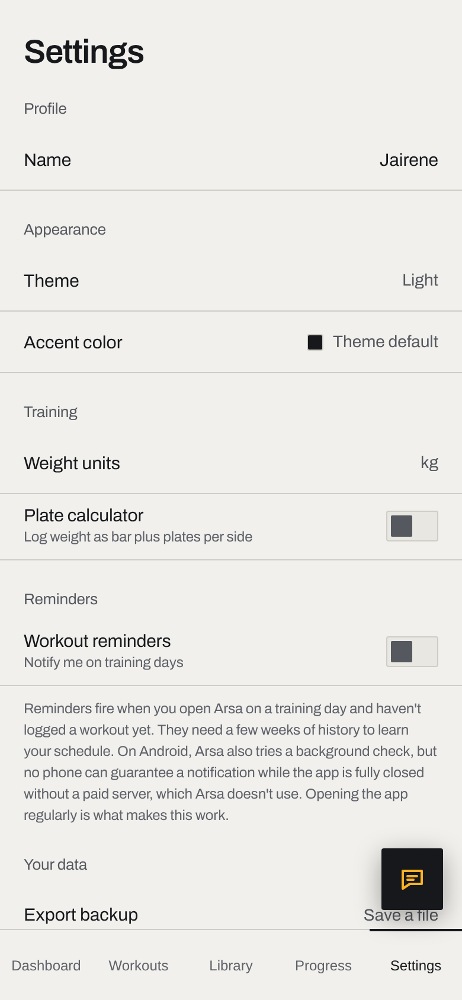
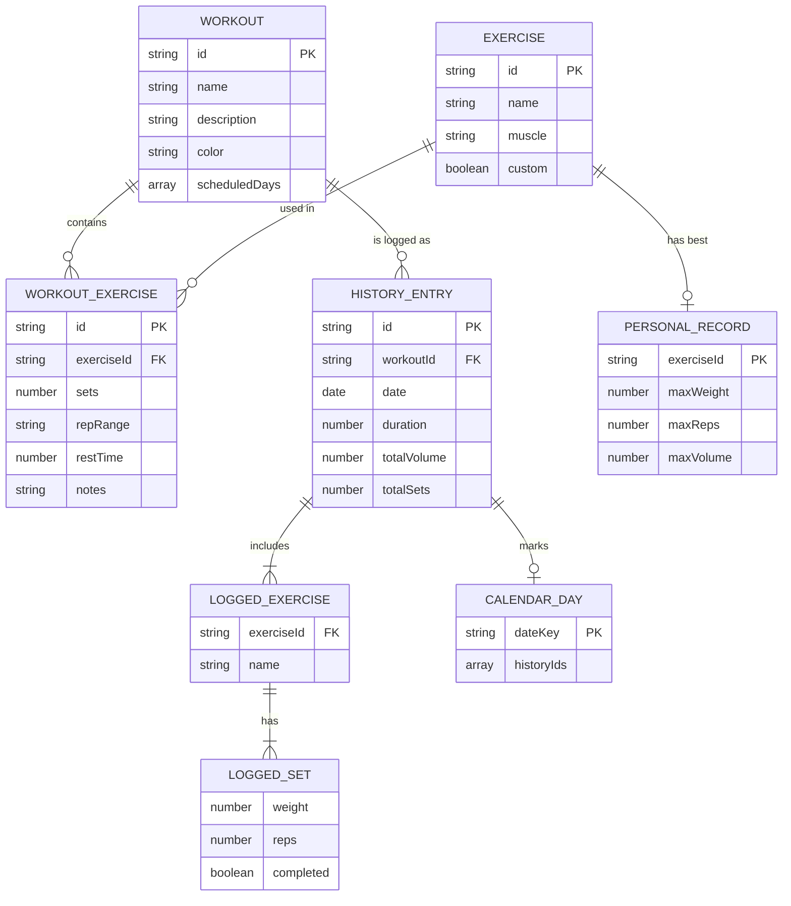

# Arsa

**A simple, private workout tracker that lives on your phone and works without internet.**

Arsa helps you log your lifting, see your progress, and stay consistent. There is no account to create, no ads, and your data never leaves your device.

<p align="center">
  
  
  
</p>

> **Try it:** `https://ja1rene.github.io/arsanewversion/`

---

## 1. Project overview

### The problem
Most gym apps want you to sign up, pay for a subscription, or stay online. Many are also cluttered, so logging a set between rests takes more taps than it should. And if you use paper notes or a notes app, you can't see your progress at a glance.

### The idea
Arsa is built around one question: *"What did I lift last time, and can I beat it today?"*

- Open the app, pick a workout, and see last session's weight and reps next to each set.
- Tap **Same** to repeat it, or **Try** to nudge it up a little.
- Finish, and Arsa updates your records, streak and charts for you.

It is a **PWA** (Progressive Web App). That means you open it in your browser and can install it on your home screen like a normal app, with no app store needed.

---

## 2. Features

**Training**
- Build your own workouts with exercises, sets, a rep range and rest time
- Start from ready-made training splits: Full Body, Upper/Lower, Push Pull Legs, and a 5-day body-part split
- Live session screen with a rest timer, quick **Same** / **Try** buttons, and +/- steppers for weight and reps
- Made a mistake? Undo an added set, remove a set, or fix a logged one
- Plate calculator for loading the barbell

**Progress**
- Dashboard with today's workout, weekly volume, body weight and a 12-week activity grid
- Streak that follows your own training pattern, not a fixed daily rule
- Personal records tracked automatically (heaviest weight, most reps, biggest volume)
- 38 awards with progress bars
- Charts per exercise, plus a full history

**Library**
- 22 built-in exercises with instructions and muscle groups
- Add your own custom exercises

**Coach (works offline)**
- A small chat button that answers lifting questions ("How do I deadlift?", "Do I need a deload?")
- It also knows *your* data: "What's my best bench?", "Which muscles am I neglecting?"
- It runs entirely on your phone. Nothing is sent anywhere.

**Protection against lost work**
- A half-built workout is saved as you type, so a reload, back swipe or closed tab won't erase it
- An unfinished workout session survives a refresh
- Export and import backups

**Everything else**
- Dark and light themes, accent colors, kg or lbs
- Optional daily reminder
- "Update available" banner when a new version is released
- Works offline after the first visit

---

## 3. Technologies used

| What | Used for |
|---|---|
| **HTML, CSS, JavaScript** (no framework) | The whole interface. Plain files, easy to read and change |
| **LocalStorage** | Saving your data on your device |
| **Service Worker** | Offline support and caching |
| **Web App Manifest** | Makes it installable on the home screen |
| **Archivo + Martian Mono** fonts | Typography (bundled locally, so it works offline) |
| **GitHub Pages** | Free hosting |

**What it does not use:** no PHP, no MySQL, no server, no build step, no npm packages. You can open the folder and edit any file with a text editor.

---

## 4. Screenshots

| Dashboard | Workouts | Builder |
|:--:|:--:|:--:|
|  |  |  |

| Live session | Progress | Library |
|:--:|:--:|:--:|
|  |  |  |

**Light theme**

| Dashboard | Workouts | Settings |
|:--:|:--:|:--:|
|  |  |  |

---

## 5. Data design

Arsa has no database server. Everything is stored as one JSON object in the browser's LocalStorage under the key `arsa-data-v1`. Think of it as one small database with a few "tables", shown below the way you would draw an ERD.



Other small pieces of data kept next to these: `weightLogs` (body weight entries), `achievements` (unlocked awards), `settings` (theme, units, name) and `activeSession` (a workout in progress).

Two extra keys keep drafts and chat safe: `arsa-workout-draft` (an unsaved workout) and `arsa-coach-chat` (the Coach conversation).

All reading and writing goes through one file, `js/data.js`, so the rest of the app never touches storage directly.

---

## 6. Installation guide

You only need a browser. There is nothing to install.

### Run it on your computer

1. **Download the code**
   ```bash
   git clone https://github.com/ja1rene/arsanewversion.git
   cd YOUR-REPO
   ```
   (or press **Code → Download ZIP** on GitHub and unzip it)

2. **Start a tiny local server.** Use any one of these:
   ```bash
   # if you have Python
   python3 -m http.server 8000

   # or if you have Node
   npx serve
   ```
   Or use the **Live Server** extension in VS Code.

   > Opening `index.html` by double-clicking will show the app, but offline mode and installing only work when it is served from a web address (`localhost` counts).

3. **Open** `http://localhost:8000` in your browser.

### Put it online for free (GitHub Pages)

1. Push the project to GitHub.
2. Go to **Settings → Pages**.
3. Under **Source**, choose your main branch and the root folder, then save.
4. After a minute, your app is live at `https://ja1rene.github.io/arsanewversion/`.

### Install it on your phone

- **Android (Chrome):** open the link, then menu → **Install app** or **Add to Home screen**.
- **iPhone (Safari):** open the link, tap **Share**, then **Add to Home Screen**. (iPhone only offers this in Safari, not in other browsers.)

### Releasing an update

Edit `APP_VERSION` in `service-worker.js` (for example `1.10.0` → `1.11.0`), add a note to `js/changelog.js`, and push. People who have the app installed will see an **Update available** banner.

### Folder map

```
index.html            The single page that holds every screen
manifest.json         Install details (name, icons, colors)
service-worker.js     Offline cache and update handling
css/                  Styles (tokens.css holds the colors and fonts)
js/
  data.js             Saving and loading (the "database")
  app.js              Navigation, theme, updates
  dashboard.js        Home screen
  workouts.js         Workout list and builder
  session.js          The live workout screen
  library.js          Exercise library
  progress.js         Charts, records, awards, history
  settings.js         Settings, backup and restore
  coach.js            Offline coach (answers in coach-kb.js)
  splits.js           Ready-made training splits
fonts/  icons/        Bundled fonts and app icons
```

---

## 7. Security and privacy

Arsa is a small app with no server, which removes most of the usual risks. Here is what it does, in plain terms.

- **Your data stays on your device.** There is no account, login, or database online. Nothing about your workouts, weight or Coach chats is sent anywhere.
- **No tracking.** No analytics, no ads, no third-party scripts, and no outside font or image requests.
- **Protection against injected code (XSS).** Anything you type (workout names, notes, custom exercises) is escaped before it is shown on screen, so typed text can't turn into running code.
- **Input checks.** The exercise form only accepts numbers where numbers belong, with limits (for example, 1 to 20 sets, rest up to 15 minutes). The set logger rejects impossible values.
- **Safe saving.** Unsaved work is stored as a draft, and destructive actions (delete, discard, reset) ask for confirmation first.
- **HTTPS.** GitHub Pages serves the app over HTTPS, which is also required for the service worker to run.
- **Backups are yours.** Export a backup file any time and import it on another device.

**Honest limits.** Because data lives in the browser, clearing site data or uninstalling the app can erase it. Export a backup now and then. Anyone who picks up your unlocked phone can open the app, since there is no passcode inside it.

---

## 8. Future improvements

- **Safer backups:** check that an imported file is valid before it replaces your data, and keep an automatic safety copy
- **Backup reminders** and one-tap saving to Google Drive or iCloud
- **Optional online Coach** for deeper answers, always opt-in
- **Sync between devices** (for example phone and tablet) with an optional account
- **Warning when storage is full** instead of failing quietly
- **More exercises** and exercise demo animations
- **Haptics and smoother screen transitions**
- **Translations** (Filipino and others)
- **Store versions** for Google Play and the App Store

Ideas are welcome. Open an issue and tell me what would make your training easier.

---

## Contributing

1. Fork the repository
2. Create a branch: `git checkout -b my-idea`
3. Make your change and test it in the browser
4. Open a pull request describing what you changed and why

---

Made by **Jairene** as a personal project, built step by step, one phase at a time.
